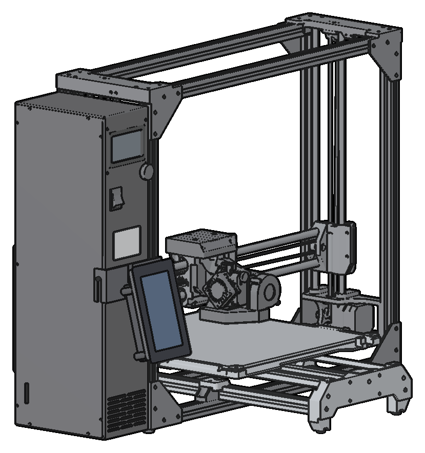
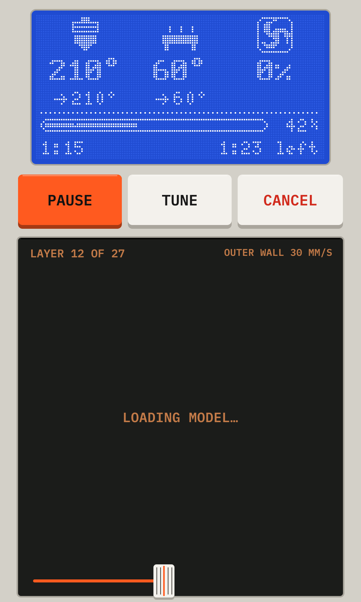
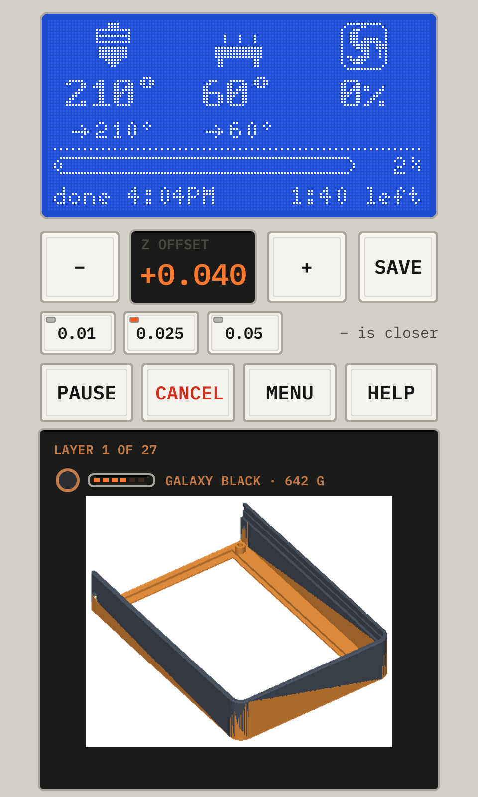
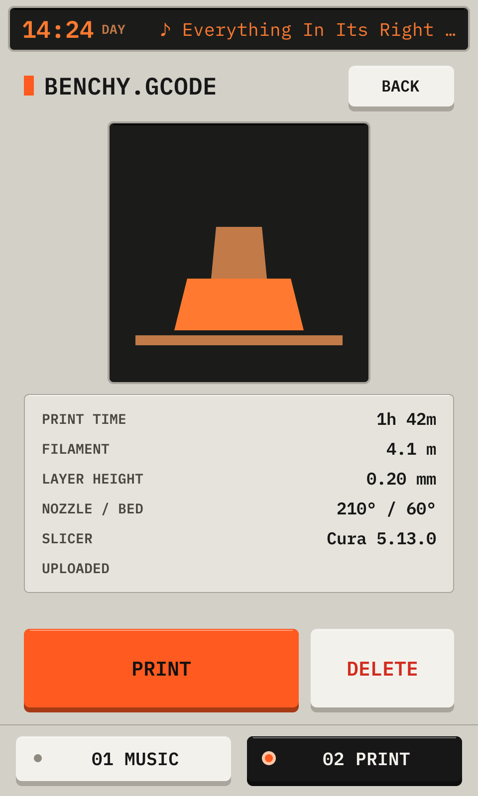
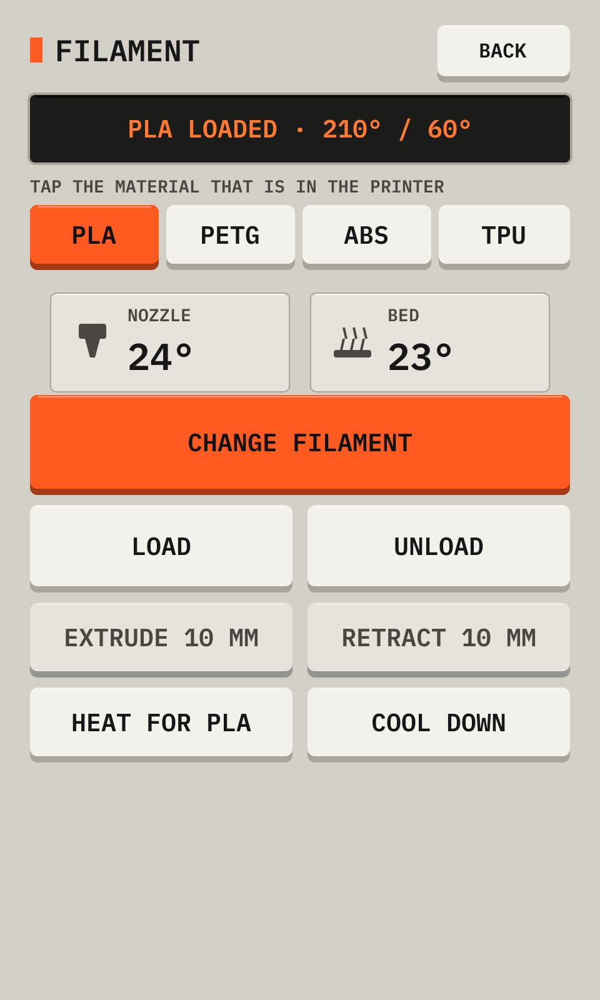

# Printdeck



The LulzBot Printdeck is a touch screen for two LulzBot printers: the LulzBot Mini 2 and the
LulzBot TAZ Workhorse. A Raspberry Pi 5 and a 5 inch touch display go on the printer in a printed
pod. The Pi runs Klipper. The deck shows and controls the print on the touch screen, on the display
of the printer, and in a browser.

Website: https://beetlebug.org/printdeck/

<p>
  
  
  
  
</p>

## Before you use it

Printdeck is a personal project, for personal use. It follows the goals of one person for print
software.

- Printdeck has run on one printer only: a LulzBot TAZ Workhorse.
- AI writes the code and the documentation. The code gets tests, and a person reads the documents.
  Errors can still occur.
- Results on your printer can be different. Use Printdeck at your own risk.

The deck can also load the Klipper example config of another printer. This documentation is for
the Mini 2 and the TAZ Workhorse.

## Install

1. Download `printdeck.img.xz` from the [latest release](https://github.com/beetlebugorg/printdeck/releases/latest).
2. Write it to an SD card with Raspberry Pi Imager ("Use custom").
3. Put the SD card in the Pi of the pod, and connect the power. The setup on the touch screen
   connects the Wi-Fi and finds the printer.

To update, open Machine > Software update on the touch screen. `os/README.md` has the details.

## Goal

Printdeck is a very small operating system with one purpose. The Printdeck program is one static
Go binary with no runtime dependencies, on a minimal Linux system. We build it from open source
projects, such as Klipper. We respect their licenses, give credit, and keep our license
compatible. We are not here to take code. We reform it into something new and give it back, in the
spirit of open source, with the help of AI. `ARCHITECTURE.md` has the plan and the rules.

Printdeck is one integrated stack. The printer firmware, the touch screen, the web screen, the
slicer integration, and the iPhone and Apple Watch apps are made to work together.

## Manual

The manual shows each screen of the deck with numbered callouts, and explains each part. The pod
shows the tall layout of the deck.

- The manual: [the web manual](https://beetlebug.org/printdeck/manual/), or the booklet
  [docs/manual/printdeck-manual.pdf](docs/manual/printdeck-manual.pdf).
- The Cura plugin: [the booklet on the web](https://beetlebug.org/printdeck/cura/), or
  [docs/cura/printdeck-cura.pdf](docs/cura/printdeck-cura.pdf). It shows the setup, the
  Printdeck tab, and the Print on a part tool.

The deck also has a wide layout, for a display that is mounted wide. Its manual is
[on the web](https://beetlebug.org/printdeck/manual/wide/), and in the booklet
[docs/manual/wide/printdeck-manual.pdf](docs/manual/wide/printdeck-manual.pdf).

Read the booklets on screen, or print them. The booklet has half-letter pages. A print shop
makes a saddle-stitched booklet from printdeck-manual.pdf. To print it yourself, print
printdeck-manual-print.pdf on both sides of letter paper (flip on the short edge), fold the
stack, and staple it in the fold.

The deck draws the pictures itself: after a change to the UI, run `docs/manual/build.sh`. After a
change to the Cura plugin, run `docs/cura/build.sh`. The documentation site in `docs/` comes from
the README files and the manuals: after a change to one of them, run `docs/build.py`.

## Hardware

The pod is a Raspberry Pi Touch Display 2 (5 inch, mounted tall) with a Raspberry Pi 5 on its
back, in a printed case. A printed bracket holds the pod on the printer: one bracket for the Mini 2,
and one for the TAZ Workhorse. [lulzbot/README.md](lulzbot/README.md) has the pod, the brackets and
the parts list. [lulzbot/stl/pod/README.md](lulzbot/stl/pod/README.md) has the print files.

| Part | Connection |
|---|---|
| Raspberry Pi 5 | Raspberry Pi 27 W USB-C power supply |
| Raspberry Pi Active Cooler | Fan connector of the Pi |
| Raspberry Pi Touch Display 2, 5 inch | DSI ribbon, and a power wire to the GPIO header of the Pi |
| SD card | Boot device |
| USB-A to USB-B cable | The board of the printer |

## Software

The Printdeck runs Printdeck OS: a small, read-only Linux system that Buildroot makes from source.
`os/README.md` tells how to build it, write it to a disk, set it up, and update it. It has:

- `deck/`, the Printdeck program (Go). It is one static binary with no cgo. It runs as the user
  `deck`, and does these things:
  - `printdeck klippy` is the Klipper host, a Go port of Klipper's `klippy.py`. The `klipper`
    service runs it in its own process. It drives the printer. `deck/internal/klipper/PORTING.md`
    tells how the port follows Klipper.
  - It draws the full screen application on the touch display, without a desktop or a browser.
  - It serves the remote screen at `http://printdeck.local`: the touch screen in a browser, with
    the password of the `printdeck` user.
  - It serves the part of the OctoPrint API that slicers use. Cura, OrcaSlicer and PrusaSlicer
    see a printer named "Printdeck", upload files to it, and start prints. Cura gets its key with
    a tap on the touch screen.
  - It follows the Klipper host through its API socket.
  - It draws the display of the printer (128 x 64) with the `printdeck_display` module of the
    Klipper host. The knob of the printer opens the same menus as the touch screen.

The screens of the touch screen:

- The top of each screen shows the display of the printer, with the same dots: the state, the temperatures, the fan, the position of the head, and the progress.
- The print screen shows a 3D view of the model that prints, in the color of the roll, with the layer, the roll, and the time of each layer above it. It can pause, resume, tune, and cancel. The view is a shaded STL if the upload folder or `MODEL_DIR` (default `/var/lib/printdeck/models`) has an STL with a matching name. Otherwise it is the toolpath from the G-code.
- Toolhead (when no print runs): home X, Y, Z; a joystick moves the head (faster further out, stops when you lift the finger); Z in steps of 0.1, 1, 10 mm; extrude and retract; fan; motors off; emergency stop. A filament swap leads through heat, unload, load, and purge.
- Tune (while a print runs): speed and flow in percent, Z offset in baby steps, fan.
- Tap a temperature to set it with a keypad.
- Machine > Settings > Theme chooses the day theme, the night theme, or auto (night from `NIGHT_FROM` to `NIGHT_TO`, 20 to 7). The choice is saved in `/var/lib/printdeck/theme`.
- Rolls: the deck keeps a list of your rolls of filament, each with a number and a color. Each print subtracts its filament from the roll in the printer, and the history shows the cost of each print. The page of each roll lists the prints that used it. `printdeck.local/rolls/labels` prints round labels with a QR code. A phone camera on a label opens the page of the roll, and Load starts the filament change with it.
- Machine > Maintenance has the calibrations of the printer, the firmware, and the pressure advance test.
- Machine > Settings > Camera sets up a USB camera (a webcam, or an HDMI capture stick): the camera, a turn of 180°, the state, and the picture to aim the camera. The webcam of the API (`/webcam/stream` and `/webcam/snapshot`, with `w` for a smaller width and `fps` for a lower rate) is then the camera, for the apps, Cura and the OctoPrint clients. The camera runs only while somebody looks, and the frames stay in memory. With no camera, the webcam is the screen of the deck.
- Machine > Settings > Notifications sends push messages to an ntfy topic: print done, print failed, a pause, the end of the first layer, and a roll that runs short. The ntfy app shows them on the phone and the watch.
- During a print, the other screens stay open to you. The controls that change the printer are locked. On a wide screen, Main is the print. On a tall screen, the print bar at the bottom goes back to the print.
- A display that is mounted wide gets the layout of a machine panel: the display of the printer and a key panel at the left, and the page at the right.
- Setup (at the first start) sets the Wi-Fi. Machine > Wi-Fi and help, and Help during a print, show the address and the password.

`slicer/` has a Cura post-processing script that sets the speed of each move. See `slicer/README.md`.
`slicer/cura-plugin/` is the Printdeck plugin for Cura: the roll in the printer, its material, and
the print in Preview. See `slicer/cura-plugin/README.md`.

## Desktop app and simulator

`desktop/` is the Printdeck for a computer. It is a Qt 6 window around `printdeck app`, which runs
the Klipper host and the deck UI for a printer on USB. Cura finds it at the same address after
each start, as it finds a Printdeck. The keyboard of the computer types on the deck. Ctrl+K
(Cmd+K on a Mac) opens the camera of the deck in a window of its own, at up to 15 frames a
second.

`printdeck app -sim` runs the deck with a simulated printer: a TAZ Workhorse on a simulated
printer board. The Simulated printer page of the deck changes it to a Mini 2. The board has the
endstops, the probe and the display of the printer, at the places in `printer.cfg`. With `-sim`, a
second window shows the printer in 3D:

- The models of the TAZ Workhorse and the Mini 2 come from the CAD files of LulzBot. The axes and
  the belts move with the steps of the board, and the filament goes down where the nozzle is.
- The Printdeck pod from `lulzbot/` is on the printer, and its screen shows the deck UI.
- The display of the printer shows the dots that the Klipper host sends to it.
- The left button turns the view, the right button pans it, and the wheel zooms. T makes the
  tool head see-through.

To build it, you need Go, CMake, Ninja, and Qt 6.5 or later with Qt Quick 3D:

```sh
B=~/.cache/printdeck/desktop
(cd deck && go build -o $B/printdeck ./cmd/printdeck)
cmake -S desktop -B $B -G Ninja -DCMAKE_BUILD_TYPE=Release
ninja -C $B
$B/Printdeck -sim
```

`desktop/film/` makes a short film of the Printdeck with the 3D window. `desktop/film/film.sh`
tells how.

## Demo mode

To look at the screens without the hardware, run `go run ./cmd/printdeck demo /tmp/shots` in
`deck/`. It writes PNG files. To use the screens in a browser, run
`go run ./cmd/printdeck remote-demo` and open `http://localhost:8080` (password `demo`).

## Work that remains

`ARCHITECTURE.md` has the plan to one Go program. The next steps:

- Lower the CPU use of the screen loop.
- Test the slicer uploads (Cura, OrcaSlicer) to the Printdeck API.

## License

Printdeck is free software under the GNU Affero General Public License, version 3. See `LICENSE`,
and the "Open source and licenses" section of `ARCHITECTURE.md`.
The iPhone and Apple Watch apps in `watch/` are under the MIT License: see `watch/LICENSE`.
The Printdeck program contains a port of Klipper's host (GPL-3.0). The OS image
contains the other packages of the image, each under its own license.
