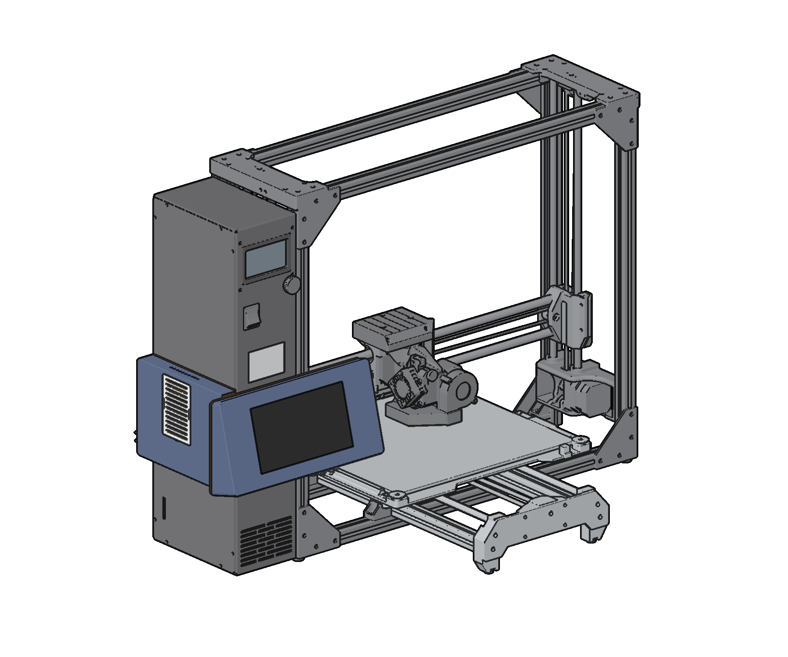

# Printdeck LulzBot

A mount for the Printdeck hardware on the LulzBot TAZ Workhorse: the Adafruit 7 inch HDMI
display with the AR1100 touch controller, a Raspberry Pi 5 with the Active Cooler, and the
2.5 inch boot drive. It is at the front left of the printer, below the TAZ Workhorse logo on the
electronics chassis, and it wraps around the front left edge of the chassis.

`printdeck-lulzbot-build.pdf` has the print plan, the hardware list, and the assembly steps.

- The head holds the display in landscape (wide view), turned 180 degrees from its native
  position: the HDMI and USB sockets are at the left, so normal straight plugs fit. The face
  leans back 15 degrees, the same as the Slate, and points to the front of the printer. The
  screen opening is at the centre of the face, so the border is the same at the left and the right.
- The head is 252 mm wide. Its left end is 20 mm past the outer face of the pod (45 mm past the
  left side of the chassis). Its right end is 207 mm to the right of the left side of the chassis,
  in front of the front left rail.
- The drive is in the head, flat on the back panel, behind the display.
- The pod is on the left side of the chassis (the aluminium cover), at the same height as the
  head. It holds the Pi and the cables. The white grille snaps into a pocket of the pod.
- There is no hole to drill. Two printed clips hold the right end of the head on the front slot
  of the rail. A metal M3 roll-in T-nut for 2020 extrusion rolls into the slot behind the
  lips, and an M3 x 8 screw from the clip pulls it up. Two screws through
  a flange of the plate hold up the head. The printer USB cable and the power cable leave at the rear face of the chassis.

## Parts

| File | Colour | Print orientation | Filament | Time |
|---|---|---|---|---|
| `stl/head.stl` | Navy | Face down | 87 g | 4 h 28 min |
| `stl/pod.stl` | Navy | Outer face down | 75 g | 3 h 45 min |
| `stl/back.stl` | Orange | Rear face down, 0.4 mm layers | 69 g | 3 h 16 min |
| `stl/plate.stl` | Orange | Cover face down, 0.4 mm layers | 58 g | 2 h 11 min |
| `stl/clip.stl` (print 2) | Orange | On its end, with a brim | 2 x 4 g | 2 x 18 min |
| `stl/grille.stl` | White | Back down | 12 g | 0 h 42 min |

In total: 309 g of PLA (navy 162 g, orange 135 g, white 12 g) and 14 h 58 min of printing. Print
the display fit test first (`stl/fit_display.stl`, 22 g, 1 h 10 min): the display pocket has
0.3 mm of clearance at each side. The numbers come from slices with the Cura profiles in `cura/`
(CuraEngine, TAZ Workhorse SE tool head, 0.5 mm nozzle, 2.85 mm PLA). The profiles keep the flow
at 12 mm3/s or less, with slower outer walls. `make.sh` checks each part: one closed mesh, no
flat ceiling, no face flatter than 40 degrees, and 0 g of support in a slice with supports on.
CuraEngine crashes on the head with supports everywhere, so the head is sliced with supports
from the build plate; the overhang check on the STL covers the rest.

## Hardware

`build/hardware.json` and page 4 of the PDF list the hardware. The list comes from the model:
each screw, washer, and heat-set insert is in the model at its place, and `make_pdf.py` stops if
the step chips and the list do not agree. All screws are M3 socket cap head screws.

- M3 x 6 socket cap head: 12 (display 4, Pi 4, drive 4). The display and Pi screws cut their
  own thread in a 2.5 mm hole in the boss: turn them until snug, no more.
- M3 x 8 socket cap head: 4 (pod onto the plate 2, rail clips into the T-nuts 2)
- M3 x 10 socket cap head: 6 (back panel into the head 4; plate on the cover 2, upper pair of PP-FP0164)
- M3 x 12 socket cap head: 2 (plate flange into the back panel)
- M3 washer: 2 (under the cover screws)
- M3 x 7 heat-set insert: 6 (head 4, back panel 2; 3 to 7 mm fits)
- M3 x 5 heat-set insert: 2 (pod blocks; 3 to 5 mm fits)
- M3 roll-in T-nut with spring ball, for 2020 extrusion, 6 mm slot: 2 (rail clips). Buy the uxcell
  M3 roll-in spring T-nut with ball, 2020 series (Amazon B09MFT1PKF). It rolls into the slot at
  any point on the rail, and the spring ball holds it in place. The LulzBot BOM uses Misumi
  HNTAP5-5 drop-in T-nuts (the M5 size) in this frame.

The rail is 2020 extrusion. The model has a typical M3 T-nut: 10 mm across the slot, 6 mm
along it, 4 mm thick, with 45 degree sides at the bottom. Its top is 1.8 mm behind the face of
the rail, so the M3 x 8 screw goes 3.9 mm into its thread. An M3 x 10 screw goes 7.7 mm behind
the face, past the bottom of the slot (about 6.5 mm), so do not use one. A printed twist nut
failed: it must be less than 5.1 mm wide to go through the lips, and the plastic around an M3
insert or an M3 thread was too thin to hold.

The drive sits on four 0.5 mm pads, so its M3 x 6 screws go 2.5 mm into the drive.

Drill the four mounting holes of the Pi 5 from 2.7 mm to 3.2 mm for M3 (step 1 of the PDF).

## Cover screws

The printer has cover PP-FP0164 (10 screws). The plate uses its upper pair of screws.
`shape.py` has their positions in one table, `COVER_SCREWS_MM`: (mm above the bottom of the
chassis, mm from the front face of the chassis).

- Front: (239.8, 6.1). Measured on the printer: 237.3 mm from the bottom edge of the cover, and
  3.6 mm from the front edge of the cover (about +-0.5 mm). The bottom of the cover is 2.5 mm above
  the bottom of the chassis, and the cover is 2.5 mm in from the front face (LulzBot model). The
  drawing gives (240.0, 6.0): the measurement agrees.
- Rear: (239.8, 163.9). From the drawing, at the same height, mirrored to 3.6 mm from the rear
  edge of the cover. To be confirmed.

The pads have slots 10 mm long (up and down) and 4.4 mm wide (+-0.5 mm front to back). Type new
values in the table and run `make.sh`.

## Software

The display is turned 180 degrees from its native position. Set `display_rotate=180` in
`printdeck.txt` on the PRINTDECK partition of the drive; the deck then uses its wide layout. If
the picture is upside down, set `display_rotate=0`.

## Display dimensions

The display dimensions come from the Adafruit CAD (in `ref/adafruit/`): the YX700WV03-T panel
datasheet, the Eagle board file of the 7 inch backpack, and the STEP model of the panel. The
Slate code has values that differ:

| Item | Adafruit CAD | Slate | Difference |
|---|---|---|---|
| Panel outline (LCM), long side | 164.9 (datasheet), 165.0 (STEP) | 166.0 | Slate pocket is 1.7 mm too long |
| LCD active area | 154.08 x 85.92 | 157 x 89 | Slate is 2.9 x 3.1 mm larger |
| Opening (active area + 0.5 each side) | 155.08 x 86.92 | 158 x 90 | Slate shows 1.5 mm of black border per side |
| Active area offset (portrait, a, b) | +2.26, +1.49 | +2.29, +1.10 (measured) | b differs by 0.39 mm |
| Board hole pitch, short side | 108.2 (brd) | 108.1 | 0.1 mm |
| HDMI socket centre | 0.9 mm from the board centre (brd) | 0 | 0.9 mm |
| Panel with touch panel, thickness | 4.9 | 7.35 (glass to board) | 2.45 mm gap |

The STEP model of the panel is an approximation: its active area is 156 x 88.9 with an offset of
about 1 mm from the datasheet. This mount uses the datasheet. The 2.45 mm between the panel and
the board is the space for the FPC fold; put foam tape there, so the glass stays on the lip.

## To check on the printer

- The position of the rear cover screw (see above).
- The height of the logo. The LulzBot drawing gives 264 mm above the bottom of the chassis, and
  the drawing is not to scale. The top of the head is at 260 mm.
- The front slot of the rail: free from 150 to 230 mm above the bottom of the chassis.
- With the bed at the front and the X axis at the bottom, the head is clear of the bed, the
  print, and the tool head.

## Files

- `shape.py` contains all dimensions. Change a value here, then run `make.sh`.
- `parts.py` makes the printed parts, the hardware, and the cables in build123d.
- `workhorse.py` reads the LulzBot model (`ref/lulzbot/final_assembly.fcstd`), the chassis and
  cover positions, and the cover screw holes of both covers.
- `model.py` builds the parts and checks the fit with a true boolean test of every pair:
  - no hardware part or cable touches a printed part, and no two printed parts overlap,
  - no part touches the LulzBot model (the chassis, the cover, the frame, the X axis, the bed),
  - each rail clip is on the centre of the rail slot, and each cover screw is within its slot over
    a hole of cover PP-FP0164,
  - every screw, washer, and insert is in the hardware list, and the counts are in stock,
  - the printer USB and the power cable go out of the rear notches, and 25 mm behind the chassis
    they touch no part of the printer,
  - the head drops onto the clip keys, and the pod slides onto its hooks, without a touch.
  It writes `cad/*.step` (each part and the assembly, on the printer) and `stl/*.stl`.
- `fit_display.py` writes `stl/fit_display.stl`.
- `cura/make_profiles.py` writes the Cura profiles, slices each part for the filament and the
  print time, and slices each part again with supports on (from the Slate).
- `render.py` writes the colour images in `renders/` (headless OpenGL with EGL).
- `lineart/render.mjs` writes the line-art images of the PDF (three.js in headless Chromium, from
  the Slate). `make_pdf.py` writes `printdeck-lulzbot-build.pdf` (same layout as the Slate guide).
- `make.sh` runs all steps (about 2 to 3 minutes). It stops if a check fails.

## Reference files

`ref/` has the files that the model uses, with their sources:

- `ref/lulzbot/`: LulzBot TAZ Workhorse v1.0.2 production files, from
  https://download.lulzbot.com/TAZ/TAZ_WE/v1.0.2/ (`production_parts/assemblies/sub_assemblies/`,
  `production_parts/machined_parts/electronics_chassis*/`, `production_docs/bom/`). License:
  GPLv3 or later and CC BY-SA 4.0 (`COPYING`, `LICENSE-CC`, `LICENSE-GPL`). The lulzbot3d
  organisation on GitHub has the firmware and the slicer, but no hardware files of the Workhorse.
- `ref/adafruit/2354_7in_TFT_Touchscreen_v3.step` and `.png`: from
  https://github.com/adafruit/Adafruit_CAD_Parts (folder `2354 7in TFT Touchscreen`). License: MIT
  (`Adafruit_CAD_Parts_LICENSE.txt`).
- `ref/adafruit/Adafruit_7in_HDMI_Backpack.brd` and `.sch`: from
  https://github.com/adafruit/Adafruit-7-HDMI-Backpack-PCB. License: CC BY-SA
  (`backpack_README.md`, `backpack_license.txt`).
- `ref/adafruit/7in_display_datasheet_c3003.pdf`: the 7 inch panel datasheet, from
  https://cdn-shop.adafruit.com/product-files/2407/c3003.pdf (linked on the downloads page of
  https://learn.adafruit.com/adafruit-5-800x480-tft-hdmi-monitor-touchscreen-backpack). No license
  is given.
- `ref/adafruit/adafruit_7inch_backpack_dimensions.png`: the 7 inch backpack drawing from the same
  downloads page. No license is given.

## Needs

`uv` (build123d, trimesh, pyrender), an OpenGL driver with EGL, Node.js, Chromium, ImageMagick 7,
and CuraEngine from the Cura AppImage in `/opt/ultimaker-cura` (the same as the Slate).
