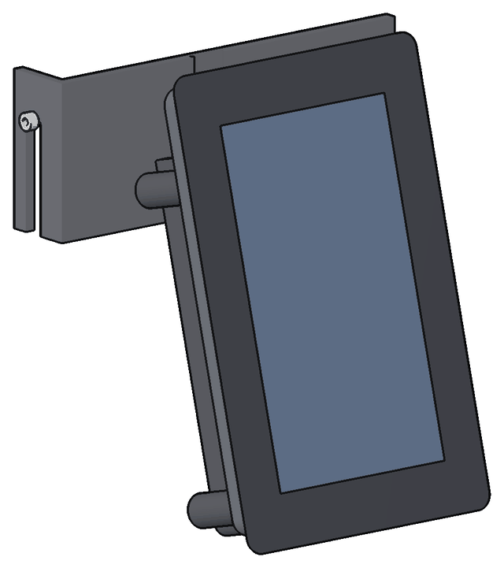
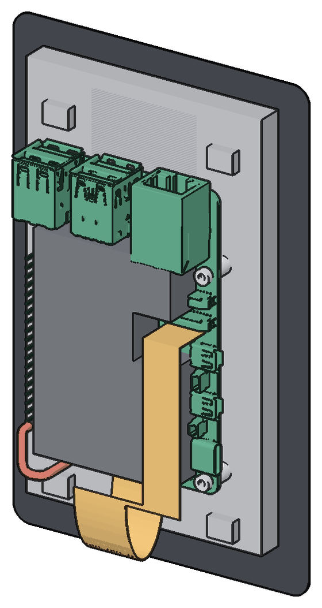
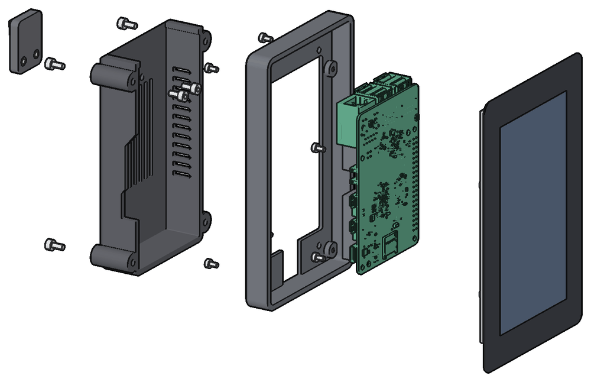
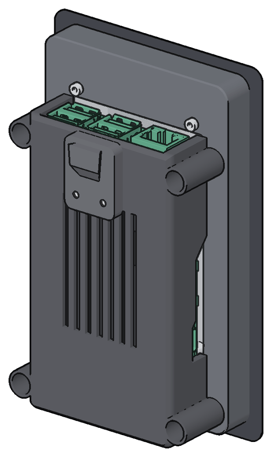
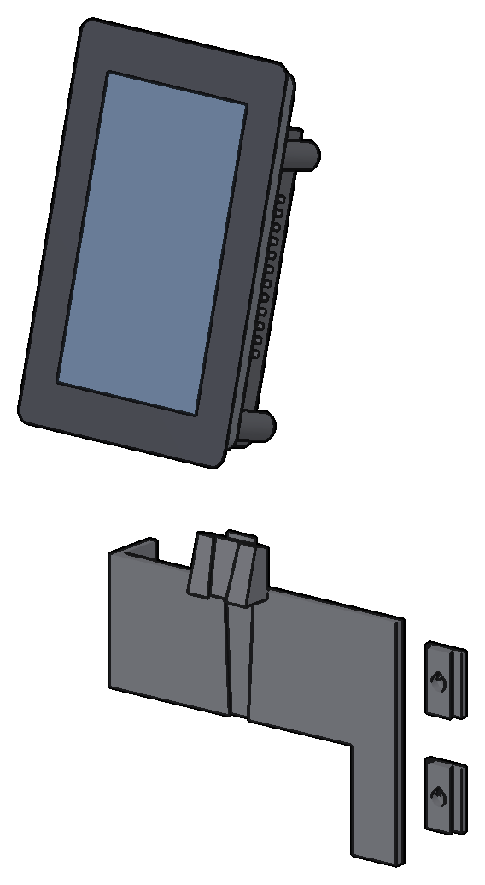
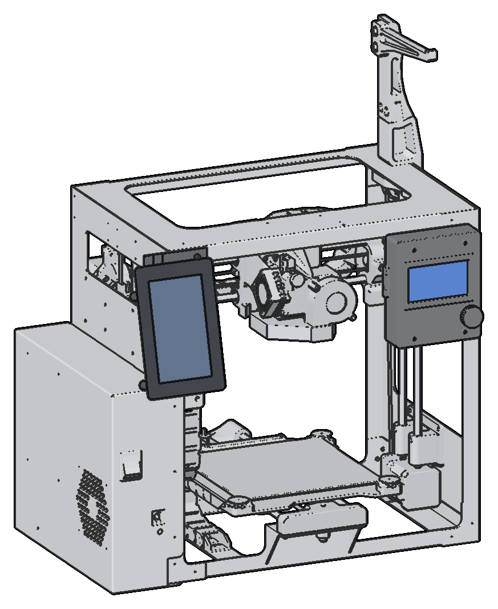

# Printdeck pod

The pod is a Raspberry Pi Touch Display 2 (5 inch, mounted tall) with a Raspberry Pi 5 on its
back, in a printed case. A printed bracket holds the pod on a TAZ Workhorse or a Mini 2.

[stl/pod/README.md](stl/pod/README.md) has the print files, the print settings, the hardware and
the webcam option.

## The pod

- The Pi 5 with its Active Cooler goes on the four standoffs of the display, USB ports up.
- Four M2.5 x 4 screws from the display box hold the frame to the four tabs of the display.
- Four M3 x 6 screws go from the back of the body into heat-set inserts in the frame.
- Two M3 x 6 screws from inside the body hold the mount to the body.
- The wedge slides down into the groove of the bracket. The dovetail of the mount drops into the
  slot of the wedge.

The display hangs with its ribbon end down. The power port and the micro HDMI ports are in the
left wall. The USB-A and Ethernet ports are in the top wall. The printer cable plugs in from
above.

To remove the pod, lift it off the dovetail and pull it forward.

## On the TAZ Workhorse

The pod goes at the front left, on the electronics chassis, below the logo. You drill no hole.

1. Put two metal M3 roll-in T-nuts (2020) in the front slot of the rail.
2. Hold each rail clip (`stl/clip.stl`) to a T-nut with an M3 x 8 screw. Print each clip on its
   end, with a brim.
3. Put the bracket on the two rail clips. Its nub goes over the edge of the side cover.
4. Fill the gap under the nub with shims, and tighten the upper front cover screw. See
   [stl/pod/README.md](stl/pod/README.md).
5. Connect the printer cable to the USB-B port on the rear of the chassis.
6. Hold the printer cable and the power cable on the side cover with five single cable clips, on
   foam tape.

## On the Mini 2

The pod goes at the top of the left upright. The stock LCD stays on the right upright.

1. Remove the two frame screws of the top left corner. Hold the bracket there with two longer
   screws (M3 x 10 in the model).
2. Connect the printer cable to the USB-B port in the front of the electronics case.
3. Hold the printer cable with the two zip-tie anchors of the bracket.
4. Hold the power cable and the printer cable on the electronics case with two double cable
   clips.

## What you need

- A Raspberry Pi Touch Display 2, 5 inch. Its box has the DSI ribbon, the power wire and the M2.5
  screws.
- A Raspberry Pi 5 with the Raspberry Pi Active Cooler.
- An SD card for Printdeck OS. See [Install](../README.md#install).
- The Raspberry Pi 27 W USB-C power supply.
- A USB cable from USB-A to USB-B, from the Pi to the printer.
- The printed parts and the hardware in [stl/pod/README.md](stl/pod/README.md). For the TAZ
  Workhorse, also two rail clips (`stl/clip.stl`), two M3 x 8 screws and two M3 roll-in T-nuts.

## Software

The display hangs upside down, so turn the picture 180 degrees. Use the Screen row of Settings,
or `display_rotate=180` in `printdeck.txt`.

## Files

- `pod.py`: the model of the pod, the brackets and the wedge, in build123d. `pod.py export`
  writes the print files. `pod.py overhangs` checks them for faces that need supports.
- `fit_holes.py`: a fit test for the display holes of the frame.
- `clips.py`: the cable clips. `camera.py`: the webcam mounts.
- `workhorse.py`, `parts.py`, `shape.py`: the TAZ Workhorse CAD, the rail clip and the rail.
- `live.py`, `viewer.py`, `cable_physics.py`: the 3D window of the model.

The other scripts in this folder are for an earlier mount with a 7 inch display.

## Reference files

- `ref/lulzbot/`: LulzBot TAZ Workhorse v1.0.2 production files, from
  https://download.lulzbot.com/TAZ/TAZ_WE/v1.0.2/. License: GPLv3 or later and CC BY-SA 4.0
  (`COPYING`, `LICENSE-CC`, `LICENSE-GPL`).
- `ref/raspberrypi/`: the product brief of the Raspberry Pi 27 W USB-C power supply.

## Needs

`uv` (build123d, trimesh, pyrender), and an OpenGL driver with EGL for the renders.
