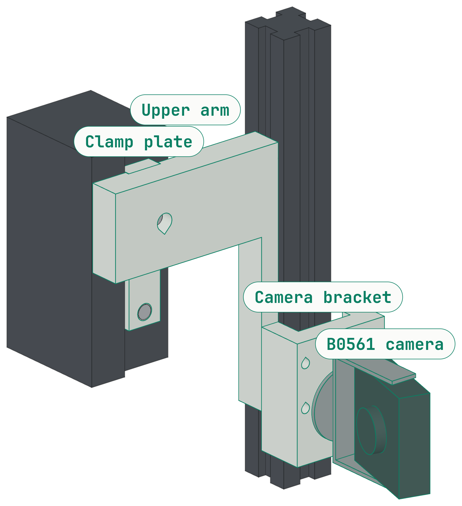

# Gantry camera arm for the TAZ Workhorse

A printed arm that holds the Arducam B0561 camera in front of the front right upright, at the
height of the nozzle. It hangs from the right X end, so it goes up and down with the gantry. The
nozzle and the layer stay at one height in the picture, from the first layer to the last. It
replaces the corner camera mount.

The arm has three printed parts, and two fit tests:

| Part | Print | What it does |
|---|---|---|
| `clamp_plate` | back face on the bed, solid | Sits in the pocket of the X end face, under the two M3 screws of that face. The lower head sinks into it. |
| `upper_arm` | upside down, top face on the bed | A beam above the tool head motor to the upright, and a drop down beside the inner face of the upright. The upper screw goes through it and the plate. |
| `camera_bracket` | bottom face on the bed | Goes around the front of the upright, under 40 mm over the tip. A vertical slot holds the 1/4"-20 screw of the camera U bracket, so the camera height is adjustable. |
| `fit_arm_slice` | top face on the bed | Fit test: the top 8 mm of the upper arm. |
| `fit_bracket_slice` | bottom face on the bed | Fit test: the top 10 mm of the camera bracket. |

All parts are PETG and print with no supports. The build PDF is
[gantry-camera-arm-build.pdf](gantry-camera-arm-build.pdf).

## The space

The arm stays out of the way of the tool head and the frame:

- The tool head at X 293: the motor passes 6 mm in front of the clamp plate. The beam is 6 mm
  over the top of the motor. The drop is 2 mm right of the BLTouch mount tab and 2 mm left of
  the upright.
- The upright: the beam stays behind the front face of the upright, so it never meets the
  corner plates. The bracket is 10 mm in front of the upright. Its top is 40 mm over the nozzle
  tip, so at Z 297 it passes 8 mm under the top corner plate.
- `model.py` checks the parts against the head at each X, and against the upright and the
  corner plates at each Z from 0 to 297.

## Hardware

- 1 M3 socket screw, 3 mm longer than the lower screw of the X end face.
- 1 M3 socket screw, 9 mm longer than the upper screw of the X end face.
- 2 M3 × 30 screws and 2 M3 nuts (bracket to arm).
- 1 1/4"-20 × 1/4" screw (camera). The screw of the old corner mount fits.

## The camera

The base of the U bracket is on the front face of the bracket, and the pivot axis is vertical.
Turn the camera on the pivot until it looks at the middle of the bed. Slide it in the slot until
the nozzle tip shows under the BLTouch. The U bracket stands on its side, so set the rotation of
this camera on the deck: the picture turns 90°.

## Files

| File | Content |
|---|---|
| `shape.py` | All dimensions, with the measurements and the estimates. |
| `parts.py` | The printed parts and the context (the X end face, the upright, the space of the head). |
| `model.py` | The fit check, the STEP and STL files, the meshes for the images. |
| `cura/make_profiles.py` | The Cura profiles, the filament, and the support check. |
| `lineart/render.mjs` | The line-art images. |
| `make_pdf.py` | The build PDF. |
| `make.sh` | Runs all the steps. |
| `MEASURE.md`, `docs/measure/` | The measurements and the pictures for them. |
