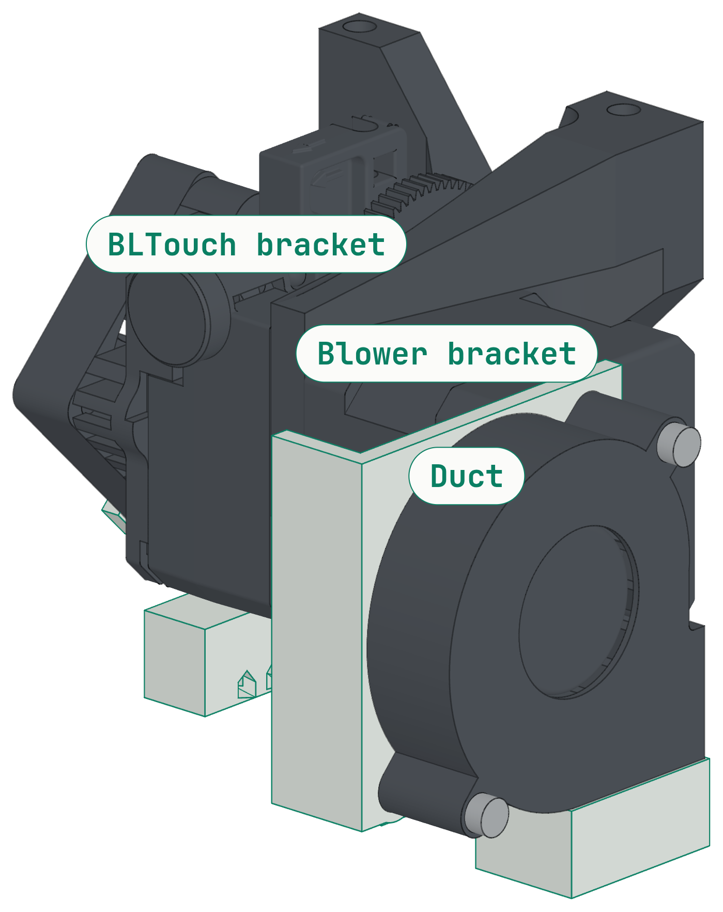

# SE tool head duct (TAZ Workhorse)

A new part cooling duct for the LulzBot SE tool head, with two brackets:

- **Duct.** A U round the hot end. The air leaves through outlets on the right, the back and the
  left. The front is open, so you and the cameras see the nozzle. Two screws of the stock duct hold
  it: the front bottom motor screw (the front tab goes between the Aero and the motor) and the long
  screw at the back left of the Aero (the post).
- **Blower bracket.** A 3 mm plate on the end cap of the extruder motor, under the two front motor
  screws (now countersunk). The 50 x 15 mm blower lies flat on it, the intake to the right and the
  outlet down at the back, into the lip of the duct. It stays inside the space of the old BLTouch
  mount, so the gantry camera arm (PR #25) still clears it at X max.
- **BLTouch bracket.** It goes on two screws of the heat sink fan and holds the BLTouch behind the
  fan. The pin is 25 mm left of the nozzle and 23 mm behind it, so the probe reaches the full bed.

The parts replace the stock duct and the BLTouch mount of `lulzbot/bltouch/mount`.

## Sources

- The LulzBot SE tool head CAD (`lulzbot/ref/lulzbot/sl_toolhead/Achemon_sphynx_assem.fcstd`, from
  download.lulzbot.com/TAZ/accessories/tool_heads/SE_0.5mm/, GPL and CC BY-SA). `cad.py` reads the
  Aero, the motor, the mount, the fans, the stock duct and the blower from it.
- The X carriage and the X ends from `lulzbot/ref/lulzbot/final_assembly.fcstd`. The stock head of
  that file hangs from the same two inserts as the SE head, and its nozzle tip is at the same place.
- The measurements of the BLTouch mount: the gap from the motor to the right X end at X max.

The estimates are in `MEASURE.md`.

## Files

| File | Content |
|---|---|
| `shape.py` | All the dimensions. ESTIMATE marks the values that are not in the CAD and not measured. |
| `cad.py` | The LulzBot CAD in the head frame (origin at the nozzle tip, x right, y back, z up). |
| `parts.py` | The printed parts, the hardware, the BLTouch and the context. |
| `model.py` | The fit check, then the STEP and STL files and the meshes for the images. |
| `cura/make_profiles.py` | The PETG profiles, the filament of each part, and the support check. |
| `lineart/render.mjs` | The line-art images. |
| `make_pdf.py` | `se-duct-build.pdf`. |
| `make.sh` | All the steps. |

Run `./make.sh`. It stops if a part touches the head, the X carriage, the motor connector, the right
X end at X max or the left X end at X home; if an STL file is not one closed part or has an overhang;
or if a part needs supports.

## The space (from the fit check)

| | mm |
|---|---|
| BLTouch body to the duct | 0.5 |
| BLTouch to the extruder mount | 0.4 |
| BLTouch to the X carriage | 5.6 |
| BLTouch bracket to the left X end at X home | 4.4 |
| Blower to the right X end at X max | 14.9 |
| Duct bottom over the nozzle tip (the stock duct: 5.9) | 5.0 |

## Hardware

- 2 M3 countersunk screws (ISO 10642), 1 mm shorter than the front motor screws of the BLTouch mount.
- 1 M3 x 18 socket screw and 1 M3 square nut (DIN 562), 1 M3 x 25 socket screw and 1 M3 nut: the blower.
- 2 M3 x 16 button head screws: the heat sink fan, through the BLTouch bracket.
- 2 M3 x 12 socket screws and 2 M3 nuts: the BLTouch.

## Print

PETG, 0.2 mm layers, 100 % infill, no supports. The duct is 5 mm from the heater block: do not
print it in PLA. About 47 g in all.

## The printer config

Set `[bltouch] x_offset: -25.00` and `y_offset: 23.00`, then measure the real offsets with the
Probe offset row of the Calibration page. Run `PROBE_CALIBRATE` for the new `z_offset`, and run the
axis twist calibration again.
