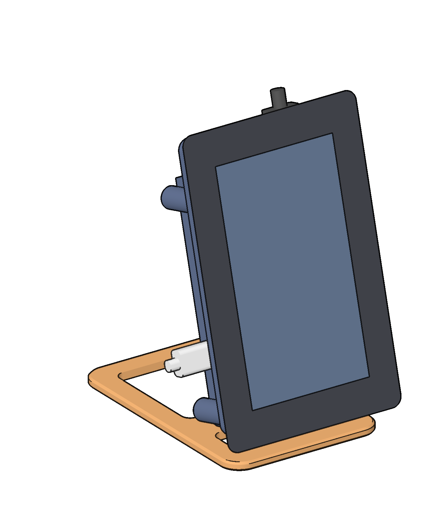
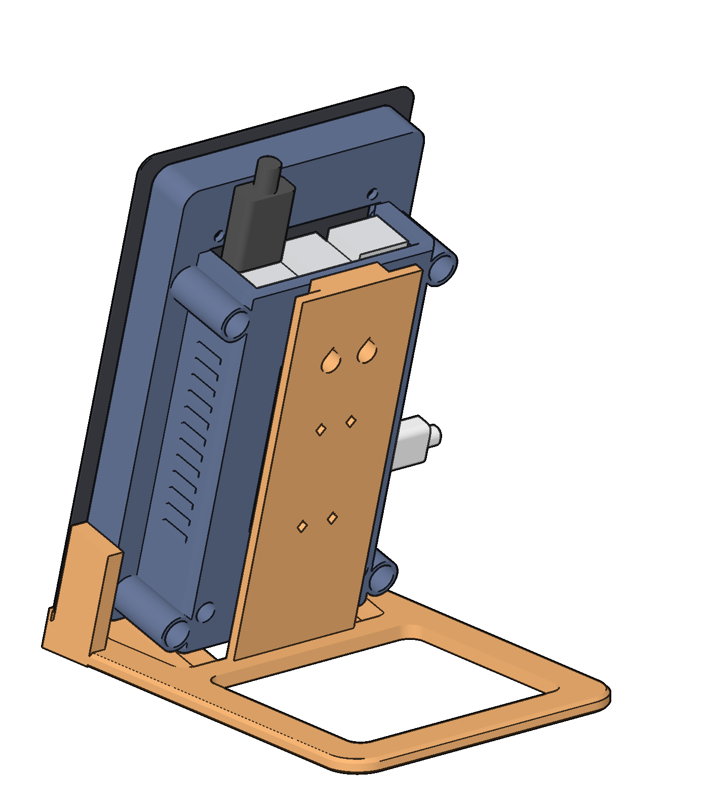
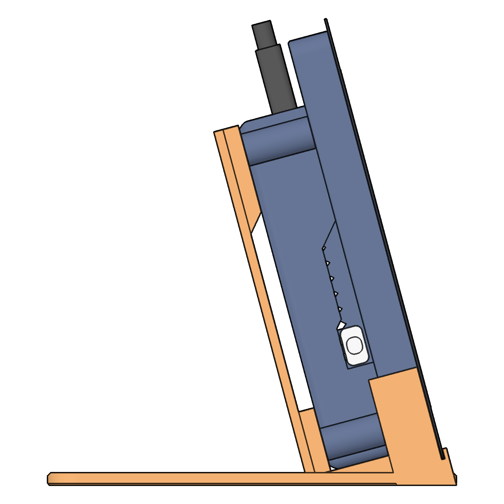
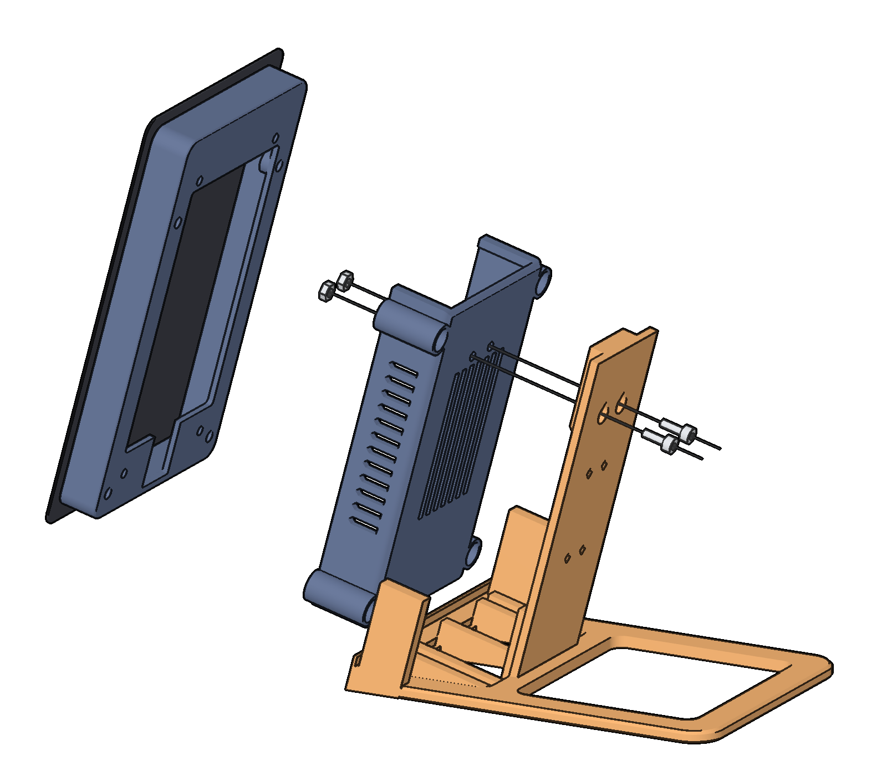
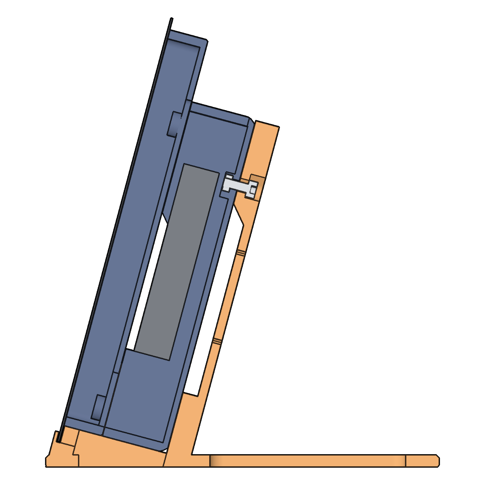
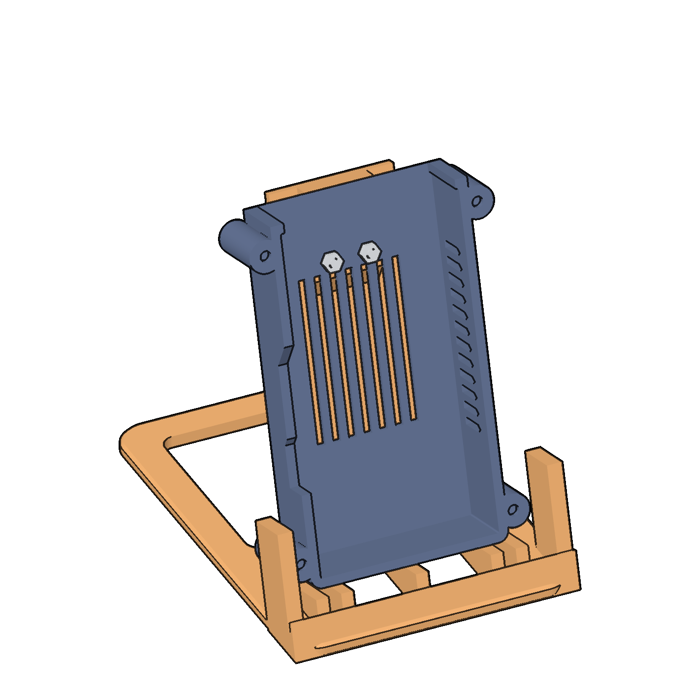

# Slate v4 print files

The Slate v4 is the desk case of Printdeck. It holds the Raspberry Pi Touch Display 2 (5 inch,
tall) and the Raspberry Pi 5 with its Active Cooler. It stands on the desk next to the printer, and
leans back 15 degrees. The navy case is the top, and the orange base is the bottom. Two M3 screws
hold the case on the base. The Slate v4 replaces the pod on the printer bracket.

The case has the shape of the pod: the frame around the display and the body around the Pi. The
ports of the Pi are flush with the walls of the body. The power port and the micro HDMI ports are in
the left wall. The USB-A and Ethernet ports are in the top wall.

The base is one part:

- The chin goes across the full width of the glass, under its bottom edge. A lip goes in front of
  the bottom edge of the glass.
- The cheeks go up beside the frame, under the edges of the glass, to below the ports in the left
  wall.
- The case stands on five ribs.
- The back plate is 5 mm behind the body, so the air gets to the vents in the back of the body. A
  boss at its top and a pad at its bottom touch the back of the body. The two screws pull the body
  onto the boss and the pad.
- The foot goes 125 mm back on the desk.

Each file is in its print orientation. `lulzbot/slate.py` makes the files from the geometry of
`lulzbot/pod.py`.

## Resin (`resin/`)

Print in resin first. The case is one part. Print it in navy resin and the base in orange resin,
or print them in any resin and paint them.

| File | Color | Supports on | Keep clean |
|---|---|---|---|
| `slate-case_resin.stl` | Navy | The open front: the rim and the inside | The back, the side walls and the ports |
| `slate-base_resin.stl` | Orange | The bottom of the foot | The lip, the cheeks, the tops of the ribs, and the boss and the pad |

- The case is turned as the resin body of the pod: the open front toward the plate, tilted 15
  degrees two ways. It stands on supports, 6 mm over the plate.
- The base is turned so that the back plate is vertical. The bottom of the foot faces the plate at
  15 degrees. It stands on supports, 6 mm over the plate.
- Both parts fit on the Peopoly Phenom. Use the `abs-like-0.05` profile. The case is 54 ml of resin
  and the base 53 ml, before the supports.
- The case is open at the front, and the base has no closed space. Neither part needs a drain hole.

## FDM (`fdm/`)

The case in one FDM part needs supports, so it prints in two parts: the frame and the body. Four M3
x 6 screws into heat-set inserts hold them together, as in the pod.

| File | Color | On the bed | Filament and time |
|---|---|---|---|
| `slate-frame_fdm.stl` | Navy (roll-3) | Its back ring | 30.1 g, 2 h 24 min |
| `slate-body_fdm.stl` | Navy (roll-3) | Its back | 38.6 g, 3 h 24 min |
| `slate-base_fdm.stl` | Orange (roll-2) | The bottom of the foot (it stands up, 113 mm high) | 51.5 g, 4 h 38 min |

The filament and the time are from a CuraEngine slice with the `pla-0.20-standard` profile of the
TAZ Workhorse SE.

1. Turn supports off. No part needs supports.
2. Set **Z Seam Alignment** to **Sharpest Corner** and **Seam Corner Preference** to **Hide Seam**.
3. Use no brim. The foot of the base is a large first layer.

## Hardware

| Part | Count | Where |
|---|---|---|
| M2.5 x 4 screw | 8 | In the box of the display: 4 hold the Pi on the standoffs, 4 hold the display in the case |
| M3 x 8 cap screw | 2 | From behind, through the boss of the base and the back of the body, into the nuts |
| M3 hex nut (5.5 mm across the flats, 2.4 mm thick) | 2 | Pressed into the two rings on the inner floor of the body |
| M3 x 6 cap screw | 4 | FDM only: down the posts of the body into the frame |
| M3 heat-set insert, 4 mm long | 4 | FDM only: in the bosses of the frame. Press each insert flush with the face. |
| Rubber foot, 10 mm across or less | 4 | Under the corners of the foot |

## Assembly

1. Press the two M3 nuts into the rings on the inner floor of the body.
2. FDM: press the four inserts into the bosses of the frame.
3. Put the Pi 5 with its Active Cooler on the four standoffs of the display, USB ports toward the
   top of the display, with four M2.5 x 4 screws. Connect the DSI ribbon and the power wire.
4. Resin: slide the display with the Pi into the case from the front. Put four M2.5 x 4 screws
   through the back ring into the tabs of the display. Put the two upper screws in from behind,
   above the body. Put the two lower screws down the two wells in the back of the case.
5. FDM: put the frame on the display with four M2.5 x 4 screws into the tabs. Put the body on the
   frame, and put the four M3 x 6 screws down the posts into the inserts.
6. Put the case on the base. Its bottom goes on the ribs, between the cheeks and behind the lip.
   The back of the body goes on the boss and the pad.
7. Put the two M3 x 8 screws in from behind, through the boss into the nuts. Tighten them.
8. Stick the four rubber feet under the corners of the foot.

To take the display out, remove the two M3 x 8 screws, lift the case off the base, and do the steps
in the opposite order.

A pod body that is printed already has no nut rings. It also goes on the base. Put each nut on the
inner floor of the body, at the hole of the old mount, and hold it while you turn the M3 x 8 screw in
from behind. Do this before the frame and the display go on the body.

## Cables, the SD card and the air

- The power cable plugs into the left wall, above the cheek. It goes down outside the base.
- The printer cable plugs into a USB port in the top wall. Run it back over the top of the case and
  down the back plate. Hold it with two twist ties through the four holes in the back plate.
- The webcam on the printer frame (see [the pod print files](../pod/README.md#webcam-option)): its
  USB cable now runs from the printer frame to the Slate on the desk, into the lower USB 3 port.
- The microSD slot of the Pi 5 is on the underside of the board, at the end opposite the USB ports.
  In the case, that end is down, between the Pi and the display. To change the card, take the
  display out of the case.
- The Active Cooler gets its air through the vents in the back and the right wall of the body, and
  through the opening around the ports in the top wall.

## The checks

`slate.py check` gives these numbers. The masses of the display (120 g), the Pi 5 (46 g) and the
Active Cooler (22 g) are estimates, and no part was weighed. The friction factors are estimates too:
0.6 for rubber feet and 0.3 for bare plastic on wood.

- The overlaps: the base and the case, the glass, the power plug and the printer plug have no
  overlap. The resin case has no overlap with the display, the Pi, the cables or the screws.
- The Slate is about 305 g. Its center of mass is 65 mm over the desk.
- A push of 2.7 N on the top of the screen tips it back. A push of 5.8 N on the middle of the
  screen tips it back. On rubber feet, a push of 2.2 N slides it before it tips. With no feet, a
  push of 1.0 N slides it.
- Tilted with no push, it falls back at 55 degrees, forward at 29 degrees, and to the side at 35
  degrees.
- The bend at the top of the screen under a push of 5 N is 0.003 mm in a beam estimate. The two
  screws hold the case on the boss and the pad, so the case and the back plate bend as one. The
  stand of the first v4, with the pod on a spine, bent 0.6 mm (FDM).

`slate.py export` writes the files and checks them. Each file is one closed part. The FDM files
pass the overhang check of `pod.py`. The base also passes the check of `make.sh`: no flat ceiling
and no face under 40 degrees.
