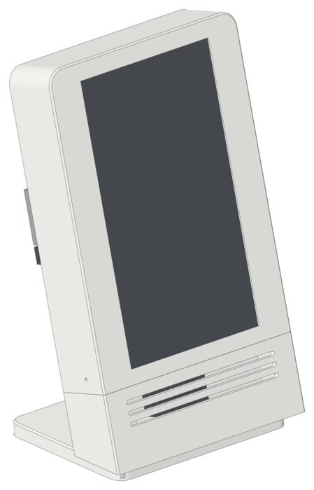

# Speakerdeck Slate

<picture>
  <source media="(prefers-color-scheme: dark)" srcset="docs/hero-dark.png">
  
</picture>

A compact slab for the Speakerdeck hardware: Raspberry Pi 5 with the HiFiBerry Amp2, the
Adafruit 7 inch touch display in portrait, the 2.5 inch SSD with its USB adapter, and the 30 mm
fan. The slab is 132 mm wide, 221 mm high, and 35 mm deep. It leans back 15 degrees on a gray
foot.

- The slab holds only the display and the drive. The Pi and the Amp2 are on the outside of the
  orange back plate, as a backpack. Every port has free space for a straight plug and the bend
  of its cable, and every plug ends inside the outline of the slab.
- The USB ports point up, so you connect them from the top of the case. The USB-C, micro
  HDMI, Amp2 power, and speaker terminals point to the left. The speaker wires go straight into the Amp2 terminals.
- No cable shows on the front or the sides. The display cables run inside the chin, out through
  two notches in the bottom edge of the back plate, and up the rear: the HDMI ribbon at the
  left, the touch USB at the right. The HDMI cable is a flat
  ribbon: a round HDMI cable cannot bend in the 10 mm under the display.
- The drive cable (micro-B SuperSpeed to USB-A) goes through a notch in the top edge of the
  back plate and down into the USB 3 port. It is short: 15 to 20 cm.
- The fan is under the Pi, on four 5 mm bosses, with four M3 screws. A heatsink cools the
  SoC.
- The back plate slides up into grooves in the slab and the chin. The chin snaps on with two
  tongues and holds the back plate. An M3 screw through each side wall of the slab holds the
  chin, and four M3 screws hold the foot to the chin. Screws hold the chin, the foot, the
  display, the drive, and the Pi, into heat-set inserts. No part needs supports.

`speakerdeck-slate-build.pdf` has the parts list, the print settings, and the assembly steps.

## Parts

| File | Colour | Print |
|---|---|---|
| `stl/slab.stl` | Navy | Front face down |
| `stl/chin.stl` | Orange | Front face down |
| `stl/back.stl` | Orange | Front face (drive side) down |
| `stl/foot.stl` | Gray | Flat, screw pockets down |

The STL files are in their print orientation. A slice of each part with supports on (support
angle 60 degrees, supports everywhere) adds 0 g of support. `make.sh` checks this.

A slab printed before the chin screws has no screw holes. Print `stl/drill_guide.stl` and
drill the two holes with it. Then drill each hole out to 6 mm, 3.1 mm deep, for the screw
head (see `drill_guide.py`). A new slab has the holes and the counterbores.

To check the screen opening before a full slab, print `stl/fit_display.stl` with the slab
profile. It is the front skin around the screen, and prints face down. Put the display glass
down into its pocket and look at the dark LCD border on each side of the opening.

Use the Cura profiles in `cura/profiles/`: run `python3 cura/make_profiles.py --install` with
Cura closed.

## Files

- `shape.py` contains all dimensions. Change a value here, then run `make.sh`.
- `parts.py` makes the printed parts, the hardware, the plug spaces, and the cables in build123d.
- `model.py` checks the fit with a true boolean test of every pair (no hardware, plug space,
  or cable touches a printed part; no two printed parts overlap; no two hardware parts or
  cables overlap, except the pairs that mate) and writes `cad/*.step` (each part and the assembly with colours),
  `stl/*.stl`, and the meshes for the renders.
- `cura/make_profiles.py` writes a Cura profile for each part, slices each part with CuraEngine
  for the filament values in the PDF, and slices each part again with supports on.
- `lineart/render.mjs` renders the line-art images in three.js in headless Chromium, in the style of the
  beetlebug.org viewer: an orthographic view, a flat fill, and dark edge lines. Each assembly step is an
  exploded view. The parts of the step are in the accent colour, with a dashed guide line to their
  position. It writes a light and a dark image of each view to `build/img/` (transparent PNG).
  `make_pdf.py` writes the PDF with the light images.
- `make_site.py` writes the project website (`../docs/index.html` and `../docs/img/`) from the
  same text as the PDF. The Pages workflow publishes it with the STL files and the PDF.
- `fit_display.py` writes `stl/fit_display.stl`, a fit test for the screen opening. `make.sh`
  runs it.
- `drill_guide.py` writes `stl/drill_guide.stl`, a guide to drill the chin screw holes in an
  older slab. `make.sh` runs it.
- `docs/` contains the finished-build image of this README.
- `make.sh` runs all steps (about 2 minutes). It stops if the fit check, the mesh check, or
  the support check fails.

## Needs

`uv` (build123d, trimesh), Node.js (three.js and puppeteer-core, from `lineart/package.json`), ImageMagick 7, Chromium, and
CuraEngine from the Cura AppImage in `/opt/ultimaker-cura`.
