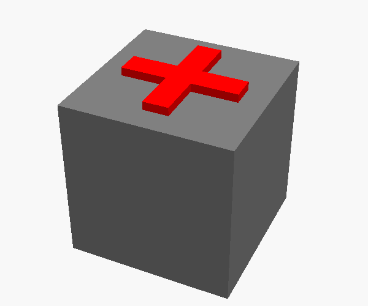

# The test print of "Print on a part"

A 20 mm cube, then a cross on its top in another color. The cross is 1 mm high, with arms of
14 x 3 mm. `cube.scad` has the two parts in one frame. `make.sh` exports `cube.stl`, `cross.stl`
and `cube.png`.

## Job 1: the cube

1. Open `cube.stl` in Cura, and print it (about 16 minutes).
2. Take the cube off the bed.

## Job 2: the holder and the cross

1. Clear the build plate. Open `cube.stl` and `cross.stl`.
2. Select the cube. In the **Print on a part** tool, tap **Set as base**. Cura adds the holder
   (the pocket) around the cube, and does not print the cube.
3. Select the cross, and tap **Place as in the files**. The cross goes on the top of the cube.
4. Print. The deck prints the holder, then lifts the nozzle and pauses.
5. Put the cube in the holder.
6. Change the filament to the second color.
7. Tap **Check the height**, and do the paper test on the top of the cube.
8. Tap **Resume**. The deck prints the cross.

Job 2 needs the deck bundle with `[printdeck_pause]` (`v0.2.0-beta.1-9` or later).

## What to look at

- XY: the cross is at the center of the top. Measure the 3 mm from each arm end to the edge of
  the cube.
- Z: the first layer of the cross sticks to the cube, and it is not squashed or in the air.
- The purge after the filament change does not go on the cube.
